# Game ideas — discussion

The working notes for choosing which games to build for this site. The games use art and sound from [Kenney](https://www.kenney.nl)'s CC0 asset packs. The preview images here are Kenney's pack previews (CC0), shown as thumbnails.

**Start here:** [Direction: the owner's notes](direction.md), the guiding principles and the ideas on the owner's radar.

## Asset galleries

- [2D asset packs](gallery-2d.md): 160 packs of sprites, tilesets and characters
- [3D asset kits](gallery-3d.md): 56 kits, almost all with web-ready GLB models
- [UI, icons, audio and other](gallery-ui-icons-audio.md): UI kits, input prompts, 16 sound packs and fonts

## What we have, at a glance

| Category | Packs | Notes for browser games |
|---|---|---|
| 2D | 160 | PNG sprites; many include spritesheets. Covers platformer, top-down, isometric, pixel art, cards, board games and puzzles. |
| 3D | 54 + 2 early access | GLB models that load straight into three.js. The animated character packs are FBX only and would need converting. |
| UI | 10 | Buttons, panels and on-screen mobile controls; one sci-fi UI pack includes fonts. |
| Icons | 8 | Game icons and keyboard/gamepad/touch input prompts. |
| Audio | 16 | About 1,400 OGG files: UI clicks, impacts, retro sounds, sci-fi, jingles, music loops and voiceovers. |

**License:** everything is CC0, so each game can include the files it uses. We'll credit Kenney on the site anyway.

## Game ideas

Ratings: **Difficulty** is how much work it is to build well. **Phone** is how well it plays on a touchscreen.

### 1. Sky Hopper (One-tap flyer)

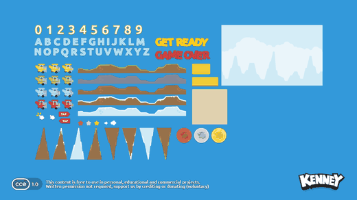

Tap to flap, slip through gaps, beat your best distance.

- **Assets:** Tappy Plane
- **Difficulty:** Easy · **Phone:** Great

### 2. Star Patrol (Vertical space shooter)

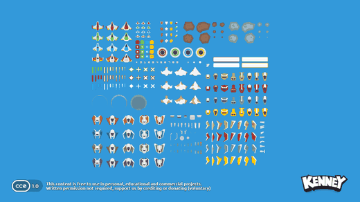 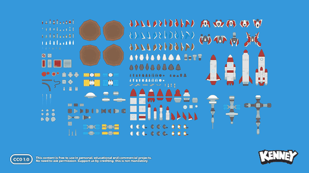

Drag to steer the ship and auto-fire; waves of enemies, power-ups and a boss.

- **Assets:** Space Shooter Remastered, Space Shooter Extension
- **Difficulty:** Easy–Medium · **Phone:** Great

### 3. Box Pusher (Sokoban-style puzzle)

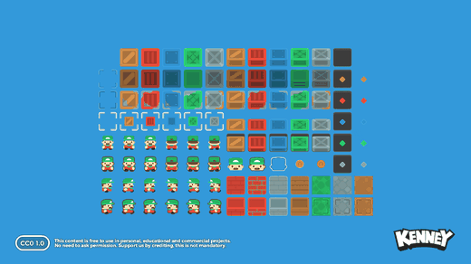

Swipe to push crates onto targets; 20–30 hand-tuned levels with undo.

- **Assets:** Sokoban Pack
- **Difficulty:** Easy · **Phone:** Great

### 4. Solitaire Table (Card game)

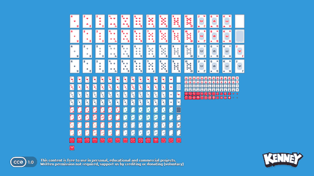

Klondike first, with FreeCell or Spider later on the same card engine.

- **Assets:** Playing Cards Pack
- **Difficulty:** Easy–Medium · **Phone:** Good

### 5. Word Tiles (Word puzzle)

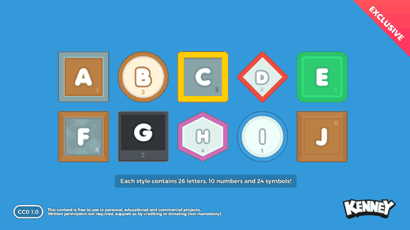

Build words from a rack of letter tiles against the clock (needs a word list).

- **Assets:** Letter Tiles Redux
- **Difficulty:** Medium · **Phone:** Great

### 6. Gem Swap (Match-3)

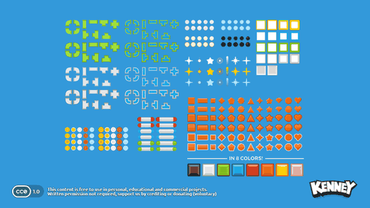

Swap neighbouring pieces to make rows of three, with cascades and combos.

- **Assets:** Puzzle Pack 2
- **Difficulty:** Medium · **Phone:** Great

### 7. Pixel Leap (Side-scrolling platformer)

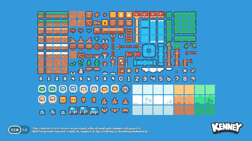 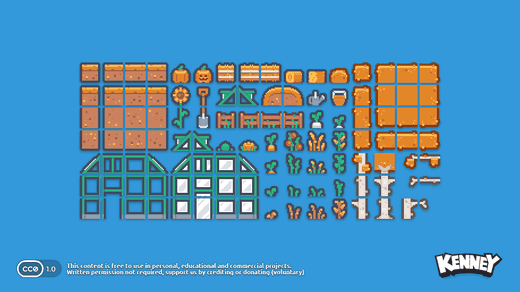

Run, jump and collect across several short levels; on-screen buttons on phones.

- **Assets:** Pixel Platformer, Pixel Platformer Farm Expansion
- **Difficulty:** Medium · **Phone:** OK (needs touch controls)

### 8. Tank Arena (Top-down arena shooter)

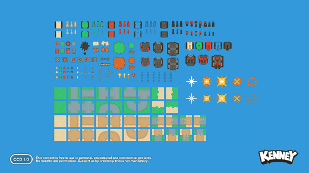

Twin-stick tank battles against AI waves.

- **Assets:** Topdown Tanks Remastered
- **Difficulty:** Medium · **Phone:** OK (twin-stick)

### 9. Knock 'Em Down (Physics launcher)

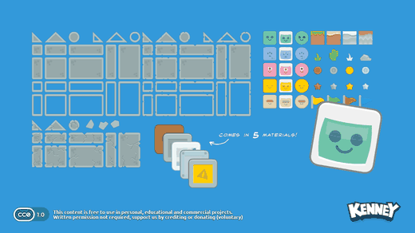

Pull back and fling projectiles to topple block towers.

- **Assets:** Physics Assets
- **Difficulty:** Medium · **Phone:** Great

### 10. Tiny Delve (Turn-based roguelike)

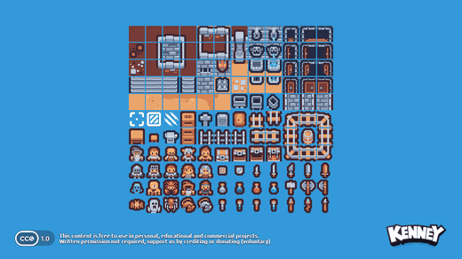

Explore generated dungeon floors one step at a time: loot, monsters, permadeath.

- **Assets:** Tiny Dungeon
- **Difficulty:** Medium–Hard · **Phone:** Great (turn-based)

### 11. Path Defense (Tower defense)

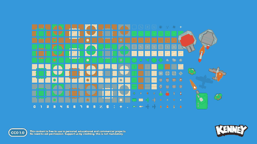 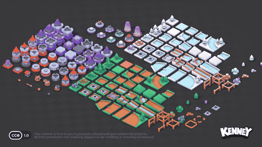

Place and upgrade towers along a path to stop enemy waves. Comes in 2D or 3D.

- **Assets:** Tower Defense, Tower Defense Kit
- **Difficulty:** Medium · **Phone:** Good

### 12. Putt Putt 3D (3D minigolf)

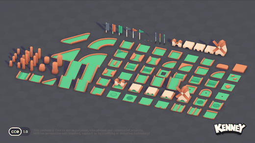

Drag back to aim and set power; nine holes built from the kit's modular track pieces.

- **Assets:** Minigolf Kit
- **Difficulty:** Medium · **Phone:** Great

### 13. Marble Run (3D tilt maze)

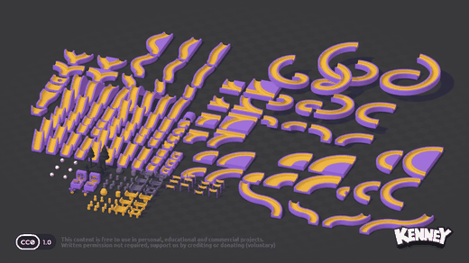

Tilt the phone, or use the arrow keys, to roll a marble along tracks without falling off.

- **Assets:** Marble Kit
- **Difficulty:** Medium · **Phone:** Great (tilt)

### 14. Toy Racer (3D arcade racer)

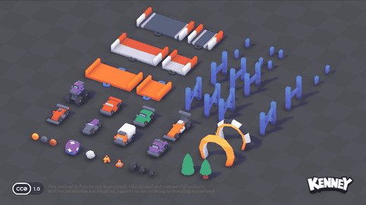

Toy cars on desk-top tracks, against the clock or AI.

- **Assets:** Toy Car Kit
- **Difficulty:** Hard · **Phone:** OK

### 15. Little Town (Cozy builder)

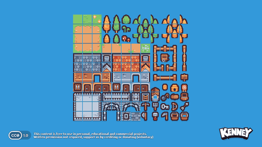

Place houses, roads and trees on a grid to grow a small town with simple goals.

- **Assets:** Tiny Town
- **Difficulty:** Hard · **Phone:** Good

## My suggestion for the first round

Superseded by [the owner's direction](direction.md): start with 2D games, isometric included, and aim for variety. We'll choose the first pair from those ideas.

## How each game will be built

- Each game is a self-contained folder in the `games` repo, e.g. `googly-faces/`, with only the assets it uses copied in.
- Plain HTML/JS, with a small library only where a game needs one (e.g. Phaser for 2D, three.js for 3D). There's no build step: Cloudflare serves the repo's files as they are.
- The landing page is a grid of game tiles. Each game has a back button to the landing page.
- Touch first: phone, then tablet, then desktop with mouse and keyboard.
- The site is a PWA with a manifest and a service worker, so it installs to the home screen and works offline once loaded.

## Decisions log

- **2026-11-05:** variety across game types is the main driver; mix short-form and long-form games; every game needs sound, good performance, a special hook and an elegant feel.
- **2026-11-05:** touch first (phone, then tablet, then desktop); every game runs in the browser and the site installs as a PWA.
- **2026-11-05:** the landing page shows 6 tiles (two rows of three on wide screens): Googly Faces, Pixel Leap, Shooting Gallery, High Seas, Runes and Orbit (Runes, a puzzle with the Rune Pack, replaced Marble Machine). Upcoming games are dimmed "Coming soon" tiles. The names are working titles. *(Superseded on 2026-11-07: Reef's tile went first, so the page shows 7 tiles.)*
- **2026-11-05:** the first game is **Googly Faces**: tap-only and sound-led, to play with a child. The Shooting Gallery comes later.
- **2026-11-05:** start with 2D games. Isometric games use the same 2D engine for now; 3D comes later.
- **2026-11-06:** hosting is Cloudflare (Workers static assets, connected through the Cloudflare GitHub app), which the owner chose for its preview link on every PR. The site stays plain HTML, CSS and JS with no build step, and sounds are MP3 because Safari doesn't play OGG.
- **2026-11-06:** the site lives only at **https://games.meirmsn.dev**, a Cloudflare custom domain set for production and previews. Each PR's preview is at `<branch>.games.meirmsn.dev`. The workers.dev addresses are off, in the dashboard and in `wrangler.jsonc`, so there's one address and nobody installs a duplicate app.
- **2026-11-06:** **Googly Faces** is the first playable game. It's drawn on one canvas with no library: the pupils are hand-rolled physics (gravity, the eye's own movement, bouncing off the rim and rolling to rest), and they follow the device's tilt where motion sensors are available. A round is twelve faces, counted by coloured dots rather than numbers, and ends with a small party and a play-again button. Its 22 short sounds are pops, boings, giggly squiggles, squeaks and a closing jingle, each played at a slightly varied pitch. The bodies use the pack's double-size PNGs, because the default ones look blurry on phone screens.
- **2026-11-07:** after playing it, the owner asked for three changes to **Googly Faces**: the landing tile now shows faces drawn by the game itself (`scripts/make-tile.mjs`), so it looks like the game; a dot that fills swells and pushes the row aside before settling, so each tap visibly changes the counter without any explaining; and a tap on the background makes every eye look at it. Then, on the owner's next ask, the eyes keep following the pointer (a mouse as it moves, a finger as it slides) for about two seconds after that tap, before rolling loose again.
- **2026-11-07:** the second playable game is **Reef** (`reef/`), built on the **Fish Pack** at the owner's request: eat smaller fish, dodge bigger ones, grow to dive through five depths. Its tile goes first on the landing page, ahead of Googly Faces, which makes 7 tiles. Its difficulty is tuned for flow: risk pays more, each depth adds one new idea, and a hidden assist eases off after you're caught (the notes are at the top of `reef/game.js`). The decisions and the owner's go are in [specs/reef.md](../specs/reef.md).
