# Direction: the owner's notes

[← Back to the discussion](README.md)

These are raw notes on the games the owner is interested in. They mark focus areas, not specs, and we'll come back to them when choosing what to build next.
Lines marked *Claude:* are my additions after checking the assets.

## Guiding principles

- **Variety is the main driver.** Each new game should explore a different kind of game.
- **Mix short-form and long-form games.**
- **Performance is required.** Every game has to run smoothly.
- **Each game needs something special**, its own twist or hook.
- **Every game has sound.**
- **Nothing tacky or flashy.** Games should be well done, elegant and special.
- **Touch first, then desktop.** Priority order: phone, then tablet, then desktop. Every game must be fully playable by touch, and also work with mouse and keyboard.
- **Browser and PWA.** Every game runs in the browser, and the site also installs as a PWA (home-screen icon, full screen, works offline once loaded).
- **Include a physics-driven game** as one of the categories.
- **Start with 2D.** Isometric games count as 2D and use the same 2D engine for now. 3D comes later.

## Game ideas on the owner's radar

### Puzzle game
A puzzle game of some kind; the concept is still open.

- The **Rune Pack** looks great for a puzzle game; the idea is still open.

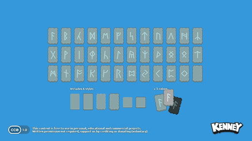

### Platformer: a world that keeps changing
- The platformer has a reason to keep going: **each world looks completely different**, because each one is drawn from a different asset pack, not only the multiple worlds within one pack. The game evolves as you go.
- **The player builds their character** with the Monster Builder Pack.
- *Claude:* candidate world packs include Pixel Platformer (+ Farm, Food and Industrial expansions), New Platformer Pack, Platformer Pack Medieval / Industrial / Nautical, Platformer Assets Candy / Ice / Mushroom / Holiday, Abstract Platformer, Scribble Platformer (+ expansion), 1-Bit Platformer Pack and Pico-8 Platformer. The challenge is that these packs differ in art style and tile size (pixel vs. vector), so we need a scale-and-style rule that keeps the change of worlds feeling deliberate rather than jarring.

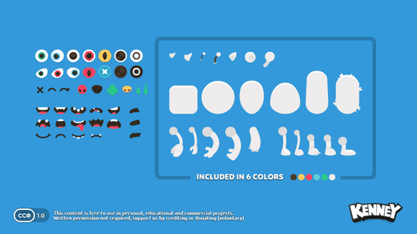

### Isometric game with ships at sea
The owner has never seen an isometric game with ships and boats on the sea, which makes it stand out.

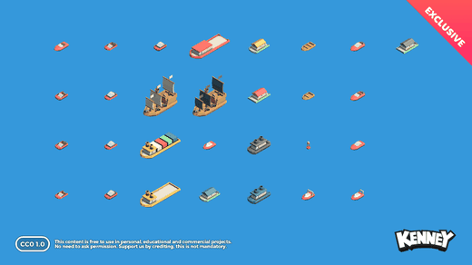

*Claude:* Isometric Watercraft has boats from rowboats to pirate ships and cargo vessels. Isometric Vector Roads Water and Isometric Nature could supply coastlines and islands.

### Something funny to play with your child
- Combine **Shape Characters** with **Googly Eyes**.

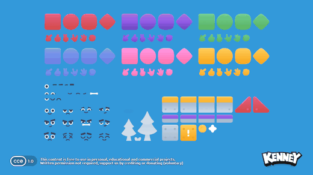 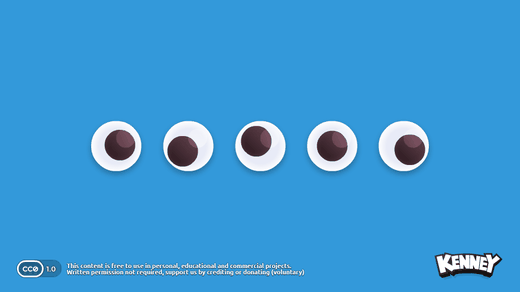

### Physics-driven game
- Physics games are their own category. **Rolling Ball Assets** is a favourite for this.
- Possible directions: **pinball**, or a **Rube Goldberg / Incredible Machine-style** contraption puzzle.

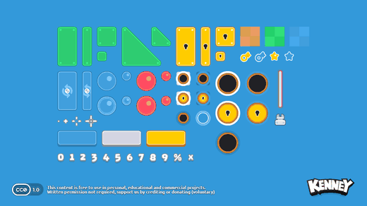

*Claude:* Physics Assets could add blocks, ropes and other parts for a contraption game.

### Robot as a character
The owner likes the **Robot Pack** and wants it as a character in one of the games; which game is still open.

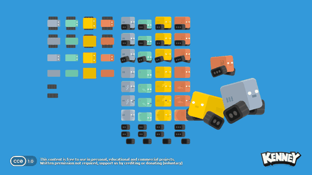

### Shooting gallery (arcade)
The owner thinks it looks amazing to build: a different, arcade-style game.

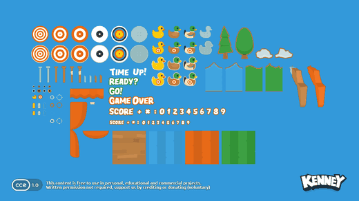

### A simple city builder
- City builders can get very complex, so this would be a **deliberately simple version**.
- *Claude:* likely packs are Tiny Town, Isometric Tiles City, Isometric Modular Buildings and Isometric Modular Roads.

### Artillery battle, inspired by Worms Armageddon
The owner loves Worms Armageddon and wants a turn-based artillery battle game with cannons.

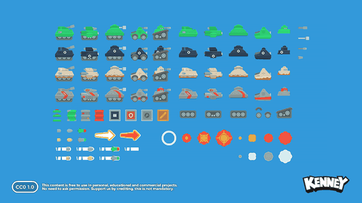 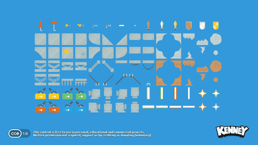

*Claude:* **Tank Pack** looks like the best fit. Its side-view tanks have barrels, shells and explosion frames. **Platformer Assets Requests** has no cannons, but its steel girders, beams, ropes and terrain chunks would make good battlefield pieces. Destructible terrain is the special part of this genre and the main technical challenge.

### Something special with the planets
- A pitch-black space background, perhaps a subtle star texture, with the planets on it. It feels different.
- The concept is still open. Maybe it's about physics, using gravity to achieve something. "Create your own planet" sounds boring.

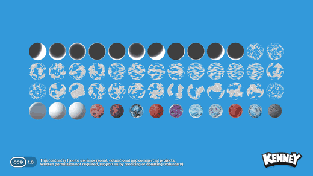

*Claude:* the pack has whole planets, phase/shadow overlays, cloud layers and separate parts, so planets can be layered and rotated. That suits a gravity-based idea well. Skyboxes Space could supply the backdrop.

### Airport seen from above
A top-down view of an airport.

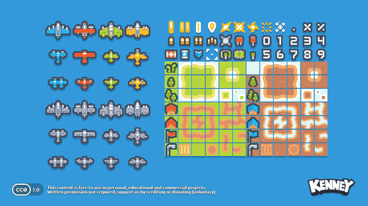

*Claude:* **Pixel Shmup** has top-down pixel planes and airfield tiles, including runways, so it fits this well. One idea is air-traffic control: guide planes in to land without collisions.

### Road-crossing arcade game, Frogger style
A lane-crossing arcade game using **Pixel Vehicle Pack**.

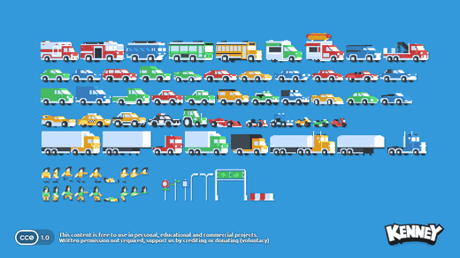

*Claude:* the vehicles are side-view, so crossing lanes would play best in a side-on or angled view rather than straight overhead. The pack also includes pedestrians and road signs.

## Shared toolkit: packs any game can use

These are generic packs to keep in mind for every game, so the games share a set of good-looking effects and extras.

| Pack | Possible uses |
|---|---|
| Explosion Pack | Explosions; worth building one good shared explosion effect for every game |
| Generic Items | Pickups, inventory, rewards |
| Flag Pack | Countries, teams, checkpoints |
| Emote Pack | Character reactions, feedback bubbles |
| Foliage Pack / Foliage Sprites | Decoration and set dressing |
| Splat Pack | Paint splats, impacts, goo |
| *Claude:* Smoke Particles, Particle Pack | Dust, trails, impacts |
| *Claude:* Light Masks | Lighting, spotlights, vignettes |
| *Claude:* Medals, Ranks Pack | Achievements, scores, progression |
| *Claude:* UI Pack (and variants), Mobile Controls, Input Prompts | Menus, on-screen touch controls, "press X" hints |
| *Claude:* Fonts | Consistent type across games |
| *Claude:* all 16 Audio packs | Interface clicks, impacts, jingles, music loops; the "must have sound" rule |
