# 2D asset packs

[← Back to the discussion](README.md)

## 2D assets (160)

<table>
<tr>
<td align="center" valign="top" width="33%">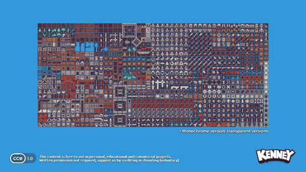 <b>1-Bit Pack</b> 22 files · Tiled maps</td>
<td align="center" valign="top" width="33%">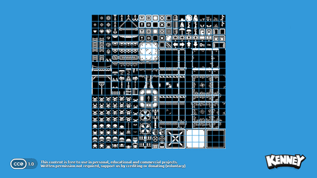 <b>1-Bit Platformer Pack</b> 809 files</td>
<td align="center" valign="top" width="33%">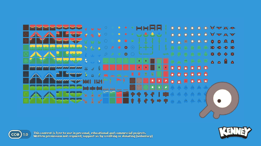 <b>Abstract Platformer</b> 392 files</td>
</tr>
<tr>
<td align="center" valign="top" width="33%">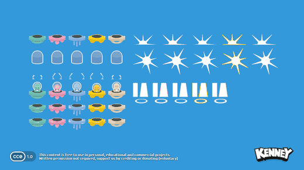 <b>Alien UFO Pack</b> 55 files</td>
<td align="center" valign="top" width="33%">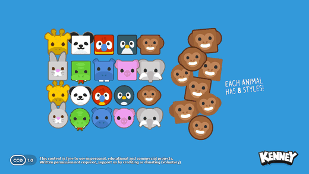 <b>Animal Pack</b> 114 files</td>
<td align="center" valign="top" width="33%">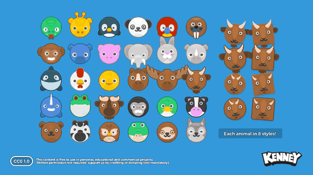 <b>Animal Pack Remastered</b> 274 files</td>
</tr>
<tr>
<td align="center" valign="top" width="33%">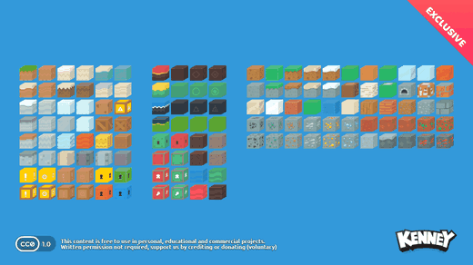 <b>Axonometric Blocks</b> 152 files</td>
<td align="center" valign="top" width="33%">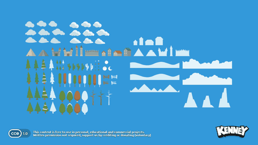 <b>Background Elements</b> 131 files</td>
<td align="center" valign="top" width="33%">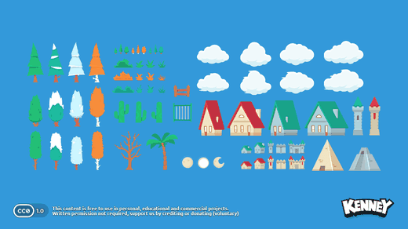 <b>Background Elements Remastered</b> 169 files</td>
</tr>
<tr>
<td align="center" valign="top" width="33%">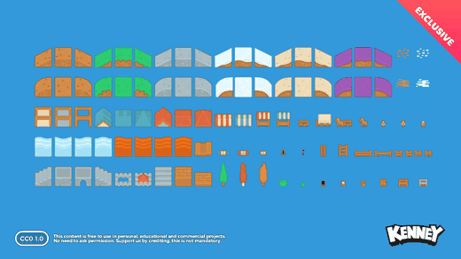 <b>Block Pack</b> 211 files</td>
<td align="center" valign="top" width="33%">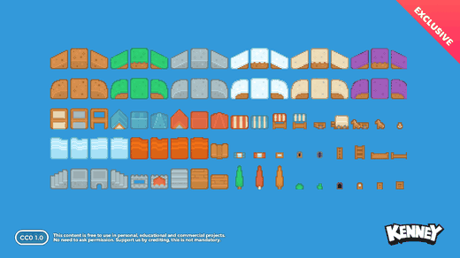 <b>Block Pack (Pixel)</b> 107 files</td>
<td align="center" valign="top" width="33%">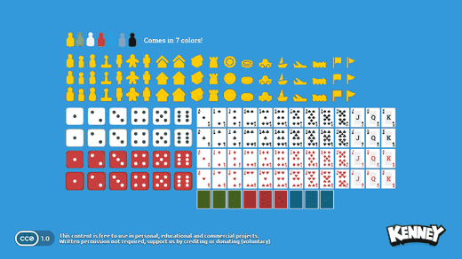 <b>Boardgame Pack</b> 571 files</td>
</tr>
<tr>
<td align="center" valign="top" width="33%">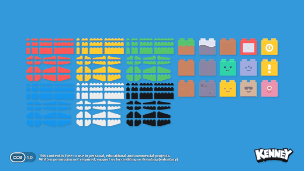 <b>Brick Pack</b> 662 files</td>
<td align="center" valign="top" width="33%">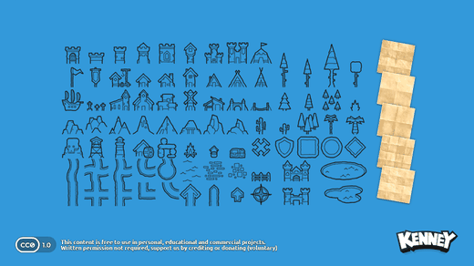 <b>Cartography Pack</b> 180 files</td>
<td align="center" valign="top" width="33%">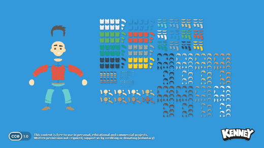 <b>Character Pack</b> 456 files</td>
</tr>
<tr>
<td align="center" valign="top" width="33%">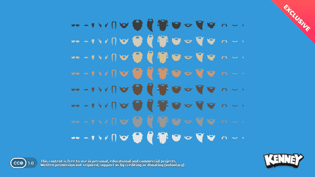 <b>Character Pack Facial Hair</b> 134 files</td>
<td align="center" valign="top" width="33%">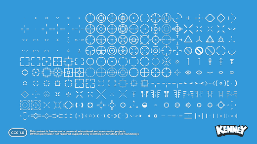 <b>Crosshair Pack</b> 2013 files</td>
<td align="center" valign="top" width="33%">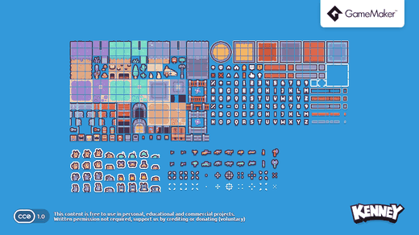 <b>Desert Shooter Pack</b> 565 files · 40 sounds</td>
</tr>
<tr>
<td align="center" valign="top" width="33%">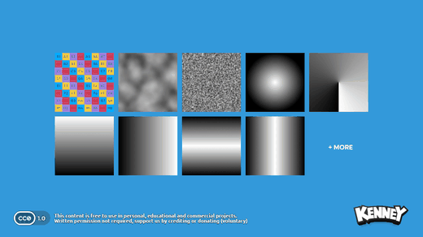 <b>Development Essentials</b> 22 files</td>
<td align="center" valign="top" width="33%">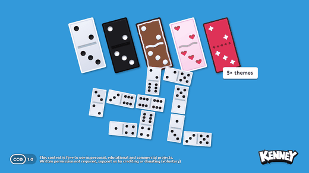 <b>Domino Pack</b> 299 files</td>
<td align="center" valign="top" width="33%">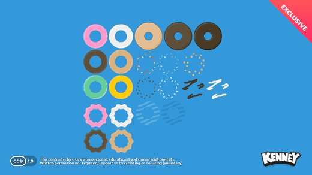 <b>Donuts</b> 29 files</td>
</tr>
<tr>
<td align="center" valign="top" width="33%">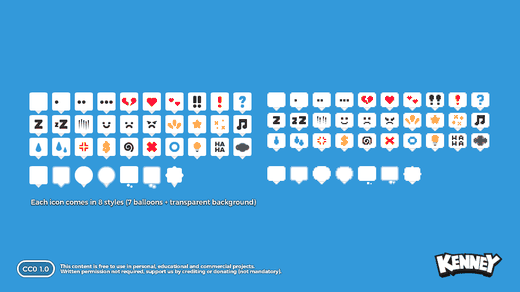 <b>Emote Pack</b> 532 files</td>
<td align="center" valign="top" width="33%">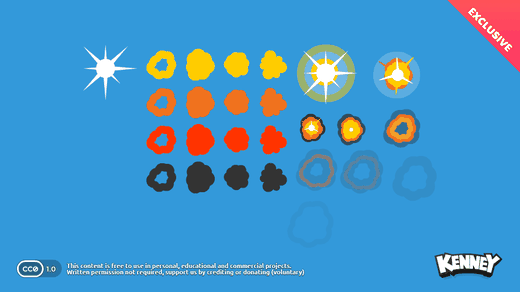 <b>Explosion Pack</b> 78 files</td>
<td align="center" valign="top" width="33%">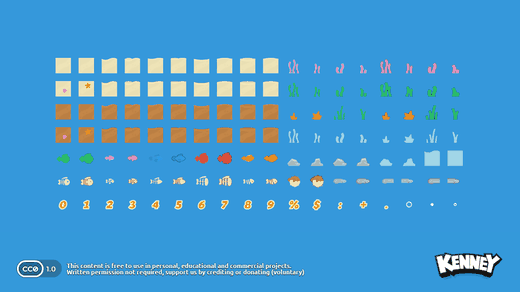 <b>Fish Pack</b> 387 files</td>
</tr>
<tr>
<td align="center" valign="top" width="33%">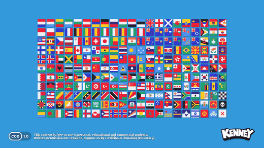 <b>Flag Pack</b> 700 files</td>
<td align="center" valign="top" width="33%">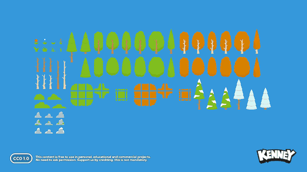 <b>Foliage Pack</b> 223 files</td>
<td align="center" valign="top" width="33%">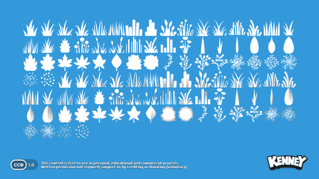 <b>Foliage Sprites</b> 105 files</td>
</tr>
<tr>
<td align="center" valign="top" width="33%">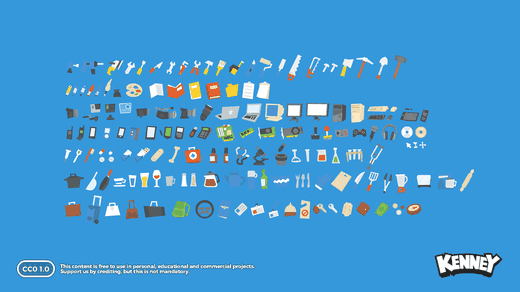 <b>Generic Items</b> 336 files</td>
<td align="center" valign="top" width="33%">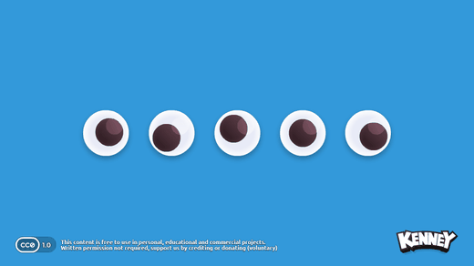 <b>Googly Eyes</b> 12 files</td>
<td align="center" valign="top" width="33%">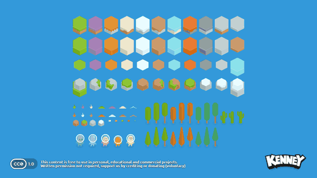 <b>Hexagon Base Pack</b> 110 files</td>
</tr>
<tr>
<td align="center" valign="top" width="33%">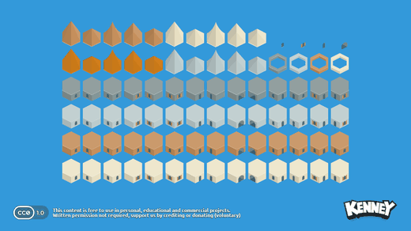 <b>Hexagon Buildings Pack</b> 91 files</td>
<td align="center" valign="top" width="33%">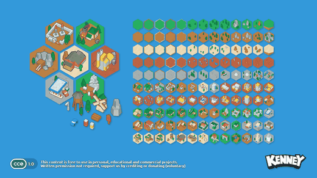 <b>Hexagon Pack</b> 327 files</td>
<td align="center" valign="top" width="33%">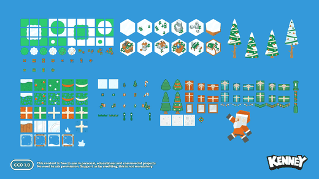 <b>Holiday Pack 2016</b> 277 files</td>
</tr>
<tr>
<td align="center" valign="top" width="33%">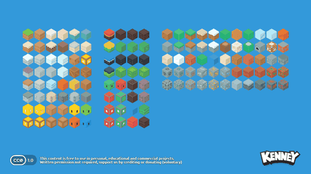 <b>Isometric Blocks</b> 150 files</td>
<td align="center" valign="top" width="33%">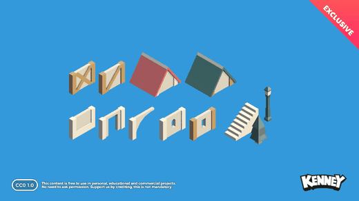 <b>Isometric Medieval Town</b> 272 files</td>
<td align="center" valign="top" width="33%">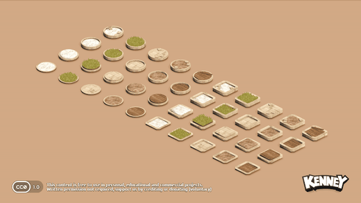 <b>Isometric Miniature Bases</b> 329 files</td>
</tr>
<tr>
<td align="center" valign="top" width="33%">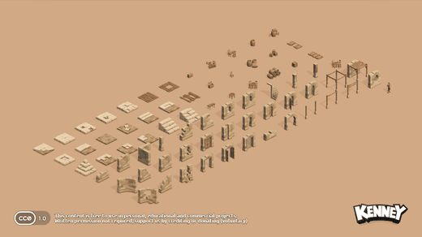 <b>Isometric Miniature Dungeon</b> 3 files</td>
<td align="center" valign="top" width="33%">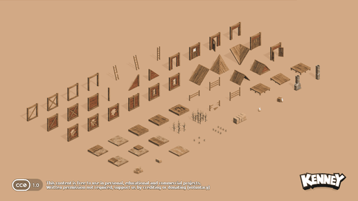 <b>Isometric Miniature Farm</b> 3 files</td>
<td align="center" valign="top" width="33%">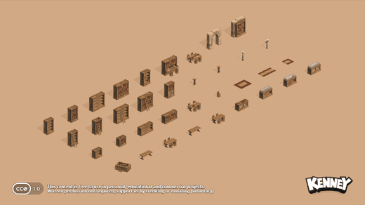 <b>Isometric Miniature Library</b> 3 files</td>
</tr>
<tr>
<td align="center" valign="top" width="33%">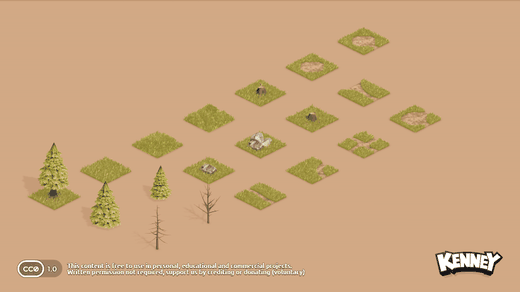 <b>Isometric Miniature Overworld</b> 2 files</td>
<td align="center" valign="top" width="33%">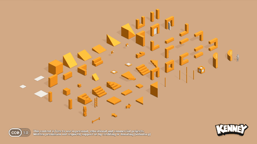 <b>Isometric Miniature Prototype</b> 3 files</td>
<td align="center" valign="top" width="33%">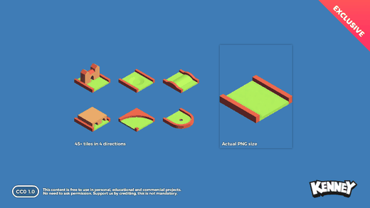 <b>Isometric Minigolf</b> 198 files</td>
</tr>
<tr>
<td align="center" valign="top" width="33%">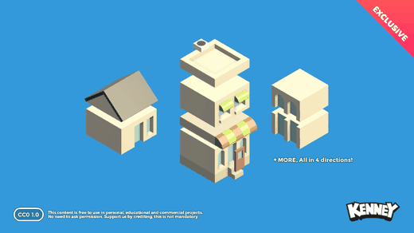 <b>Isometric Modular Buildings</b> 408 files</td>
<td align="center" valign="top" width="33%">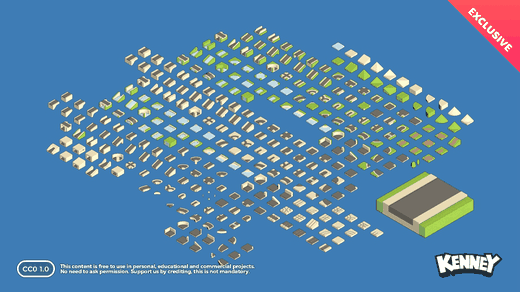 <b>Isometric Modular Roads</b> 1212 files</td>
<td align="center" valign="top" width="33%">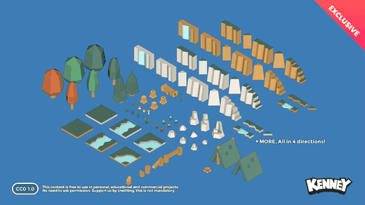 <b>Isometric Nature</b> 757 files</td>
</tr>
<tr>
<td align="center" valign="top" width="33%">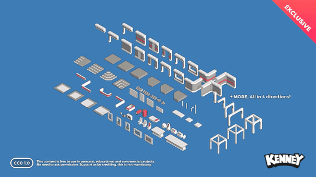 <b>Isometric Space Interior</b> 324 files</td>
<td align="center" valign="top" width="33%">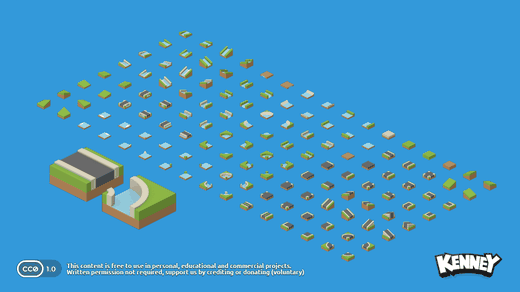 <b>Isometric Tiles Base</b> 132 files</td>
<td align="center" valign="top" width="33%">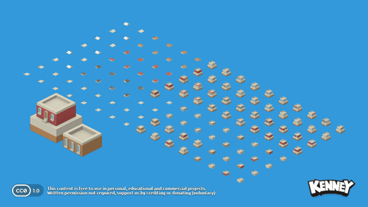 <b>Isometric Tiles Buildings</b> 134 files</td>
</tr>
<tr>
<td align="center" valign="top" width="33%">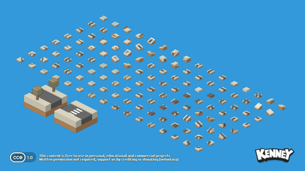 <b>Isometric Tiles City</b> 145 files</td>
<td align="center" valign="top" width="33%">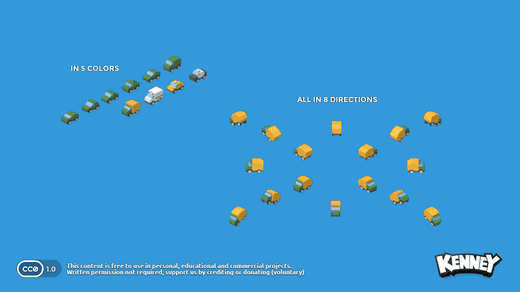 <b>Isometric Tiles Vehicles</b> 561 files</td>
<td align="center" valign="top" width="33%"> <b>Isometric Tower Defense</b> 476 files</td>
</tr>
<tr>
<td align="center" valign="top" width="33%"> <b>Isometric Vector Buildings</b> 674 files</td>
<td align="center" valign="top" width="33%"> <b>Isometric Vector Roads Base</b> 100 files</td>
<td align="center" valign="top" width="33%"> <b>Isometric Vector Roads Water</b> 46 files</td>
</tr>
<tr>
<td align="center" valign="top" width="33%"> <b>Isometric Watercraft</b> 293 files</td>
<td align="center" valign="top" width="33%"> <b>Jumper Pack</b> 128 files</td>
<td align="center" valign="top" width="33%"> <b>Letter Tiles</b> 238 files</td>
</tr>
<tr>
<td align="center" valign="top" width="33%"> <b>Letter Tiles Redux</b> 624 files</td>
<td align="center" valign="top" width="33%"> <b>Light Masks</b> 460 files</td>
<td align="center" valign="top" width="33%"> <b>Map Pack</b> 197 files</td>
</tr>
<tr>
<td align="center" valign="top" width="33%"> <b>Medals</b> 35 files</td>
<td align="center" valign="top" width="33%"> <b>Micro Roguelike</b> 329 files</td>
<td align="center" valign="top" width="33%"> <b>Minimap Pack</b> 168 files</td>
</tr>
<tr>
<td align="center" valign="top" width="33%"> <b>Monochrome Pirates</b> 427 files · Tiled maps</td>
<td align="center" valign="top" width="33%"> <b>Monochrome RPG Tileset</b> 432 files</td>
<td align="center" valign="top" width="33%"> <b>Monster Builder Pack</b> 365 files</td>
</tr>
<tr>
<td align="center" valign="top" width="33%"> <b>New Platformer Pack</b> 1333 files · 10 sounds</td>
<td align="center" valign="top" width="33%"> <b>Particle Pack</b> 195 files</td>
<td align="center" valign="top" width="33%"> <b>Pattern Pack</b> 256 files</td>
</tr>
<tr>
<td align="center" valign="top" width="33%"> <b>Pattern Pack Extra</b> 258 files</td>
<td align="center" valign="top" width="33%"> <b>Pattern Pack Lines</b> 192 files</td>
<td align="center" valign="top" width="33%"> <b>Pattern Pack Pixel</b> 137 files</td>
</tr>
<tr>
<td align="center" valign="top" width="33%"> <b>Physics Assets</b> 369 files</td>
<td align="center" valign="top" width="33%"> <b>Pico-8 City</b> 370 files · Tiled maps</td>
<td align="center" valign="top" width="33%"> <b>Pico-8 Platformer</b> 313 files · Tiled maps</td>
</tr>
<tr>
<td align="center" valign="top" width="33%"> <b>Pirate Pack</b> 410 files</td>
<td align="center" valign="top" width="33%"> <b>Pixel Line Platformer</b> 66 files</td>
<td align="center" valign="top" width="33%"> <b>Pixel Platformer</b> 252 files · Tiled maps</td>
</tr>
<tr>
<td align="center" valign="top" width="33%"> <b>Pixel Platformer Blocks</b> 336 files</td>
<td align="center" valign="top" width="33%"> <b>Pixel Platformer Farm Expansion</b> 122 files</td>
<td align="center" valign="top" width="33%"> <b>Pixel Platformer Food Expansion</b> 122 files</td>
</tr>
<tr>
<td align="center" valign="top" width="33%"> <b>Pixel Platformer Industrial Expansion</b> 122 files</td>
<td align="center" valign="top" width="33%"> <b>Pixel Shmup</b> 153 files</td>
<td align="center" valign="top" width="33%"> <b>Pixel Vehicle Pack</b> 85 files</td>
</tr>
<tr>
<td align="center" valign="top" width="33%"> <b>Planets</b> 57 files</td>
<td align="center" valign="top" width="33%"> <b>Platformer Assets Base</b> 351 files</td>
<td align="center" valign="top" width="33%"> <b>Platformer Assets Buildings</b> 105 files</td>
</tr>
<tr>
<td align="center" valign="top" width="33%"> <b>Platformer Assets Candy</b> 102 files</td>
<td align="center" valign="top" width="33%"> <b>Platformer Assets Extra Animations & Enemies</b> 186 files</td>
<td align="center" valign="top" width="33%"> <b>Platformer Assets Holiday</b> 81 files</td>
</tr>
<tr>
<td align="center" valign="top" width="33%"> <b>Platformer Assets Ice</b> 103 files</td>
<td align="center" valign="top" width="33%"> <b>Platformer Assets Mushroom</b> 58 files</td>
<td align="center" valign="top" width="33%"> <b>Platformer Assets Pixel</b> 867 files</td>
</tr>
<tr>
<td align="center" valign="top" width="33%"> <b>Platformer Assets Requests</b> 105 files</td>
<td align="center" valign="top" width="33%"> <b>Platformer Assets Tile Extensions</b> 390 files</td>
<td align="center" valign="top" width="33%"> <b>Platformer Bricks</b> 160 files</td>
</tr>
<tr>
<td align="center" valign="top" width="33%"> <b>Platformer Characters 1</b> 177 files</td>
<td align="center" valign="top" width="33%"> <b>Platformer Pack Industrial</b> 235 files</td>
<td align="center" valign="top" width="33%"> <b>Platformer Pack Medieval</b> 277 files</td>
</tr>
<tr>
<td align="center" valign="top" width="33%"> <b>Platformer Pack Nautical</b> 249 files</td>
<td align="center" valign="top" width="33%"> <b>Platformer Pack Remastered</b> 448 files</td>
<td align="center" valign="top" width="33%"> <b>Playing Cards Pack</b> 286 files</td>
</tr>
<tr>
<td align="center" valign="top" width="33%"> <b>Prototype Textures</b> 107 files</td>
<td align="center" valign="top" width="33%"> <b>Puzzle Pack 1</b> 181 files</td>
<td align="center" valign="top" width="33%"> <b>Puzzle Pack 2</b> 859 files</td>
</tr>
<tr>
<td align="center" valign="top" width="33%"> <b>RPG Tiles Vector</b> 236 files</td>
<td align="center" valign="top" width="33%"> <b>RPG Urban Pack</b> 585 files</td>
<td align="center" valign="top" width="33%"> <b>RTS Medieval</b> 264 files</td>
</tr>
<tr>
<td align="center" valign="top" width="33%"> <b>RTS Medieval (Pixel)</b> 213 files</td>
<td align="center" valign="top" width="33%"> <b>RTS Sci-fi</b> 264 files</td>
<td align="center" valign="top" width="33%"> <b>Racing Pack</b> 440 files</td>
</tr>
<tr>
<td align="center" valign="top" width="33%"> <b>Ranks Pack</b> 642 files</td>
<td align="center" valign="top" width="33%"> <b>Retro Textures Fantasy</b> 122 files</td>
<td align="center" valign="top" width="33%"> <b>Road Textures</b> 197 files</td>
</tr>
<tr>
<td align="center" valign="top" width="33%"> <b>Road Textures (Classic)</b> 85 files</td>
<td align="center" valign="top" width="33%"> <b>Robot Pack</b> 61 files</td>
<td align="center" valign="top" width="33%"> <b>Roguelike Base Pack</b> 9 files · Tiled maps</td>
</tr>
<tr>
<td align="center" valign="top" width="33%"> <b>Roguelike Characters Pack</b> 8 files</td>
<td align="center" valign="top" width="33%"> <b>Roguelike City Pack</b> 1044 files</td>
<td align="center" valign="top" width="33%"> <b>Roguelike Dungeon Pack</b> 6 files</td>
</tr>
<tr>
<td align="center" valign="top" width="33%"> <b>Roguelike Interior Pack</b> 8 files</td>
<td align="center" valign="top" width="33%"> <b>Rolling Ball Assets</b> 127 files</td>
<td align="center" valign="top" width="33%"> <b>Rune Pack</b> 692 files</td>
</tr>
<tr>
<td align="center" valign="top" width="33%"> <b>Scribble Dungeons</b> 281 files · Tiled maps</td>
<td align="center" valign="top" width="33%"> <b>Scribble Platformer</b> 218 files</td>
<td align="center" valign="top" width="33%"> <b>Scribble Platformer Expansion</b> 211 files</td>
</tr>
<tr>
<td align="center" valign="top" width="33%"> <b>Shape Characters</b> 219 files</td>
<td align="center" valign="top" width="33%"> <b>Shooting Gallery</b> 121 files</td>
<td align="center" valign="top" width="33%"> <b>Simple Space</b> 107 files</td>
</tr>
<tr>
<td align="center" valign="top" width="33%"> <b>Simplified Platformer Pack</b> 101 files</td>
<td align="center" valign="top" width="33%"> <b>Sketch Desert</b> 252 files · Tiled maps</td>
<td align="center" valign="top" width="33%"> <b>Sketch Town</b> 354 files · Tiled maps</td>
</tr>
<tr>
<td align="center" valign="top" width="33%"> <b>Sketch Town Expansion</b> 242 files · Tiled maps</td>
<td align="center" valign="top" width="33%"> <b>Skyboxes</b> 11 files</td>
<td align="center" valign="top" width="33%"> <b>Skyboxes Space</b> 12 files</td>
</tr>
<tr>
<td align="center" valign="top" width="33%"> <b>Smilies</b> 30 files</td>
<td align="center" valign="top" width="33%"> <b>Smoke Particles</b> 80 files</td>
<td align="center" valign="top" width="33%"> <b>Sokoban Pack</b> 215 files</td>
</tr>
<tr>
<td align="center" valign="top" width="33%"> <b>Space Shooter Extension</b> 565 files</td>
<td align="center" valign="top" width="33%"> <b>Space Shooter Remastered</b> 305 files</td>
<td align="center" valign="top" width="33%"> <b>Splat Pack</b> 111 files</td>
</tr>
<tr>
<td align="center" valign="top" width="33%"> <b>Sports Pack</b> 238 files</td>
<td align="center" valign="top" width="33%"> <b>Tank Pack</b> 185 files</td>
<td align="center" valign="top" width="33%"> <b>Tappy Plane</b> 89 files</td>
</tr>
<tr>
<td align="center" valign="top" width="33%"> <b>Tiny Battle</b> 208 files · Tiled maps</td>
<td align="center" valign="top" width="33%"> <b>Tiny City</b> 141 files</td>
<td align="center" valign="top" width="33%"> <b>Tiny Dungeon</b> 142 files · Tiled maps</td>
</tr>
<tr>
<td align="center" valign="top" width="33%"> <b>Tiny Factory</b> 141 files</td>
<td align="center" valign="top" width="33%"> <b>Tiny Farm</b> 141 files</td>
<td align="center" valign="top" width="33%"> <b>Tiny Ski</b> 142 files · Tiled maps</td>
</tr>
<tr>
<td align="center" valign="top" width="33%"> <b>Tiny Town</b> 141 files</td>
<td align="center" valign="top" width="33%"> <b>Toon Characters</b> 696 files</td>
<td align="center" valign="top" width="33%"> <b>Topdown Shooter</b> 635 files</td>
</tr>
<tr>
<td align="center" valign="top" width="33%"> <b>Topdown Shooter (Pixel)</b> 5 files</td>
<td align="center" valign="top" width="33%"> <b>Topdown Tanks</b> 93 files</td>
<td align="center" valign="top" width="33%"> <b>Topdown Tanks Remastered</b> 389 files</td>
</tr>
<tr>
<td align="center" valign="top" width="33%"> <b>Tower Defense</b> 605 files</td>
<td align="center" valign="top" width="33%"> <b>Voxel Expansion Pack</b> 140 files</td>
<td align="center" valign="top" width="33%"> <b>Voxel Pack</b> 208 files</td>
</tr>
<tr>
<td align="center" valign="top" width="33%"> <b>Yellow Paint Pack</b> 43 files</td>
</tr>
</table>
