# 3D asset kits

[← Back to the discussion](README.md)

## 3D assets (54)

<table>
<tr>
<td align="center" valign="top" width="33%">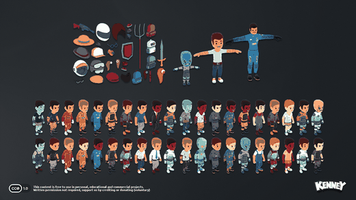 <b>Animated Characters Bundle</b> 237 files · 62 FBX (needs conversion)</td>
<td align="center" valign="top" width="33%">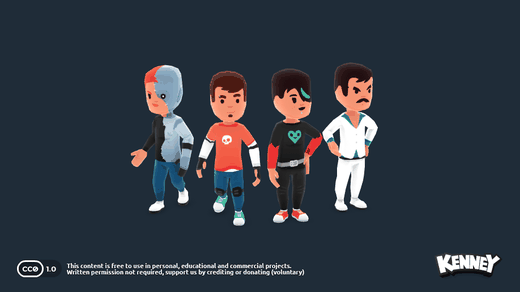 <b>Animated Characters Protagonists</b> 17 files · 4 FBX (needs conversion)</td>
<td align="center" valign="top" width="33%">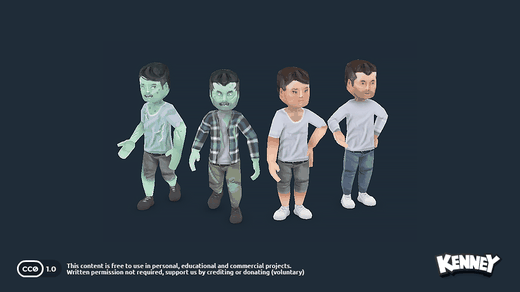 <b>Animated Characters Retro</b> 13 files · 4 FBX (needs conversion)</td>
</tr>
<tr>
<td align="center" valign="top" width="33%">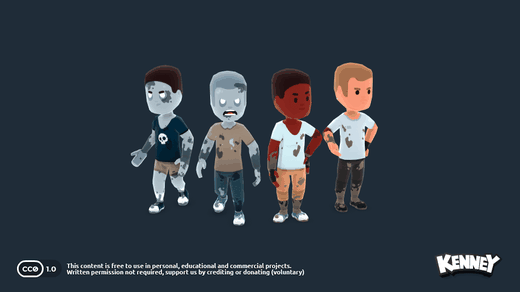 <b>Animated Characters Survivors</b> 18 files · 4 FBX (needs conversion)</td>
<td align="center" valign="top" width="33%">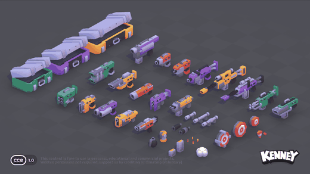 <b>Blaster Kit</b> 211 files · 40 GLB</td>
<td align="center" valign="top" width="33%">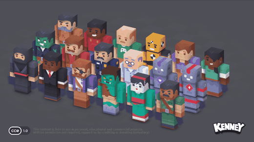 <b>Blocky Characters</b> 150 files · 18 GLB</td>
</tr>
<tr>
<td align="center" valign="top" width="33%">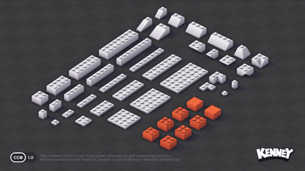 <b>Brick Kit</b> 1490 files · 296 GLB</td>
<td align="center" valign="top" width="33%">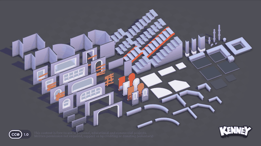 <b>Building Kit</b> 407 files · 79 GLB</td>
<td align="center" valign="top" width="33%">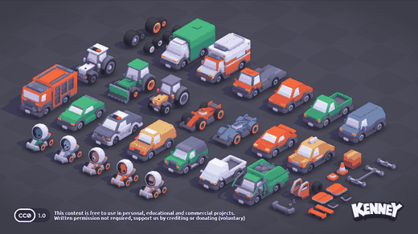 <b>Car Kit</b> 259 files · 50 GLB</td>
</tr>
<tr>
<td align="center" valign="top" width="33%">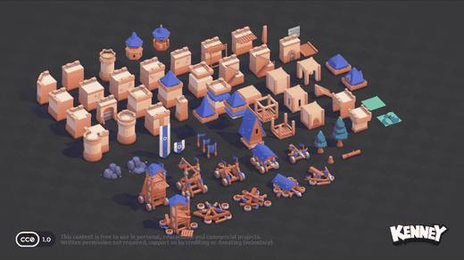 <b>Castle Kit</b> 397 files · 76 GLB</td>
<td align="center" valign="top" width="33%">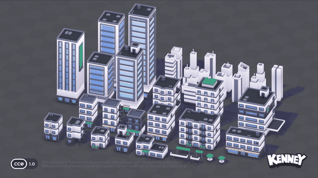 <b>City Kit - Commercial</b> 219 files · 41 GLB</td>
<td align="center" valign="top" width="33%">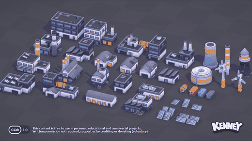 <b>City Kit - Industrial</b> 201 files · 37 GLB</td>
</tr>
<tr>
<td align="center" valign="top" width="33%">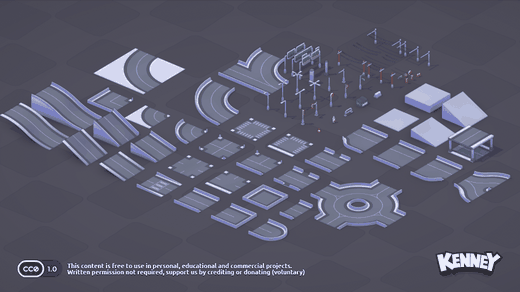 <b>City Kit - Roads</b> 487 files · 95 GLB</td>
<td align="center" valign="top" width="33%">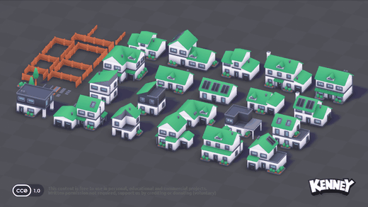 <b>City Kit - Suburban</b> 216 files · 40 GLB</td>
<td align="center" valign="top" width="33%">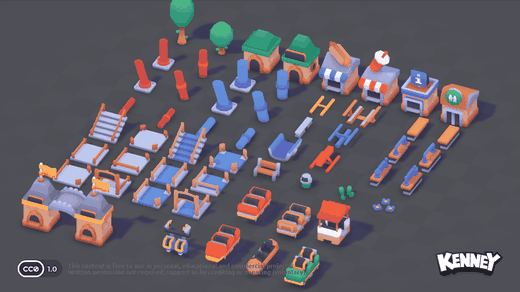 <b>Coaster Kit</b> 930 files · 183 GLB</td>
</tr>
<tr>
<td align="center" valign="top" width="33%">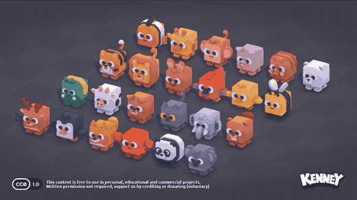 <b>Cube Pets</b> 129 files · 24 GLB</td>
<td align="center" valign="top" width="33%">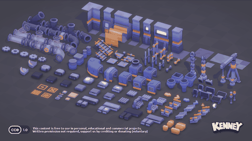 <b>Factory Kit</b> 727 files · 143 GLB</td>
<td align="center" valign="top" width="33%">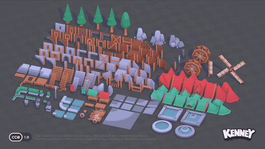 <b>Fantasy Town Kit</b> 847 files · 167 GLB</td>
</tr>
<tr>
<td align="center" valign="top" width="33%">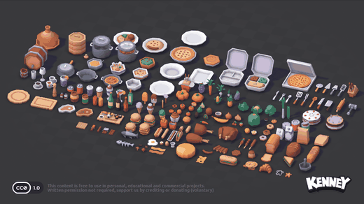 <b>Food Kit</b> 1009 files · 200 GLB</td>
<td align="center" valign="top" width="33%">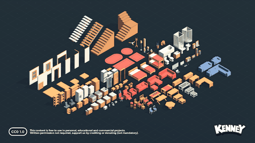 <b>Furniture Kit</b> 1406 files · 140 GLB</td>
<td align="center" valign="top" width="33%">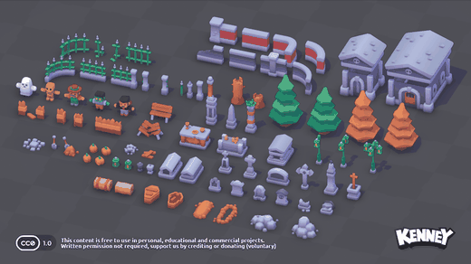 <b>Graveyard Kit</b> 465 files · 91 GLB</td>
</tr>
<tr>
<td align="center" valign="top" width="33%">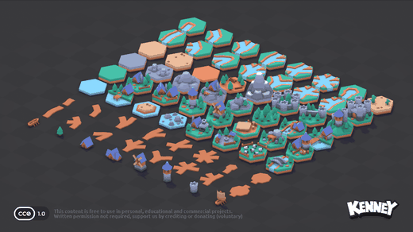 <b>Hexagon Kit</b> 374 files · 72 GLB</td>
<td align="center" valign="top" width="33%">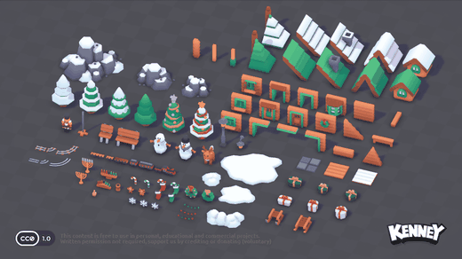 <b>Holiday Kit</b> 505 files · 99 GLB</td>
<td align="center" valign="top" width="33%">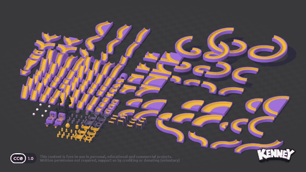 <b>Marble Kit</b> 826 files · 162 GLB</td>
</tr>
<tr>
<td align="center" valign="top" width="33%">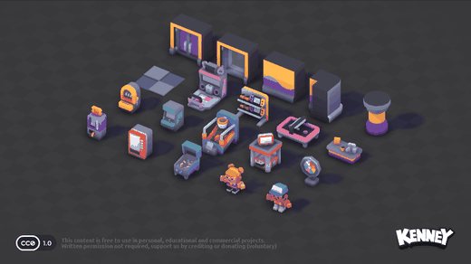 <b>Mini Arcade</b> 114 files · 20 GLB</td>
<td align="center" valign="top" width="33%">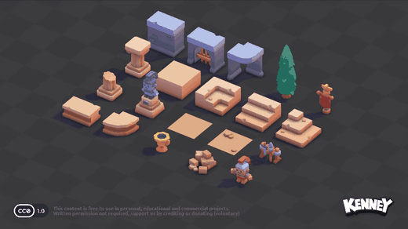 <b>Mini Arena</b> 120 files · 22 GLB</td>
<td align="center" valign="top" width="33%">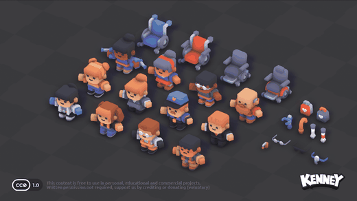 <b>Mini Characters</b> 139 files · 26 GLB</td>
</tr>
<tr>
<td align="center" valign="top" width="33%">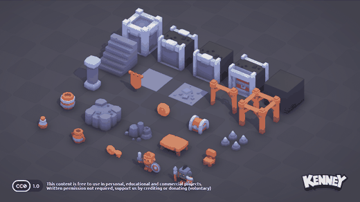 <b>Mini Dungeon</b> 162 files · 30 GLB</td>
<td align="center" valign="top" width="33%">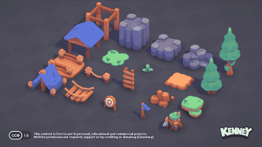 <b>Mini Forest</b> 120 files · 22 GLB</td>
<td align="center" valign="top" width="33%">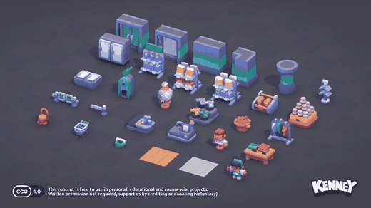 <b>Mini Shop</b> 166 files · 30 GLB</td>
</tr>
<tr>
<td align="center" valign="top" width="33%">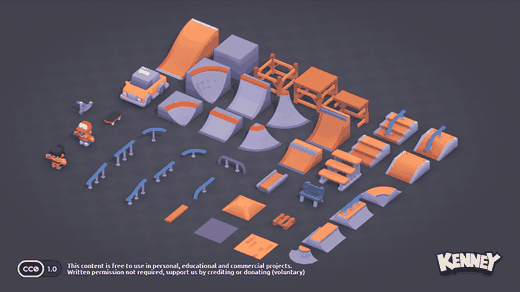 <b>Mini Skate</b> 222 files · 42 GLB</td>
<td align="center" valign="top" width="33%">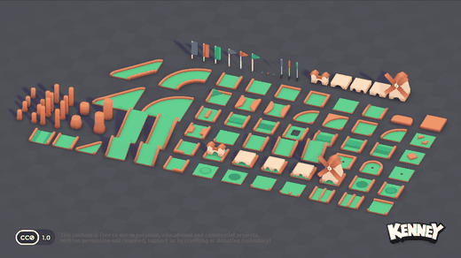 <b>Minigolf Kit</b> 646 files · 126 GLB</td>
<td align="center" valign="top" width="33%">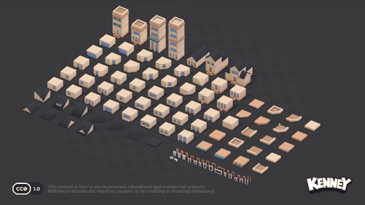 <b>Modular Buildings</b> 554 files · 108 GLB</td>
</tr>
<tr>
<td align="center" valign="top" width="33%">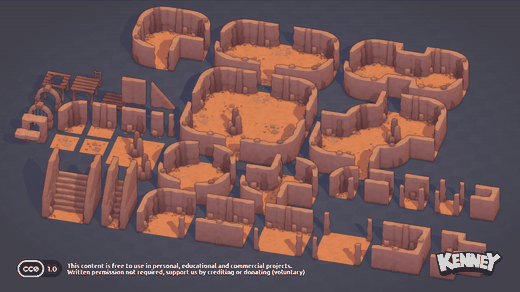 <b>Modular Cave Kit</b> 214 files · 40 GLB</td>
<td align="center" valign="top" width="33%">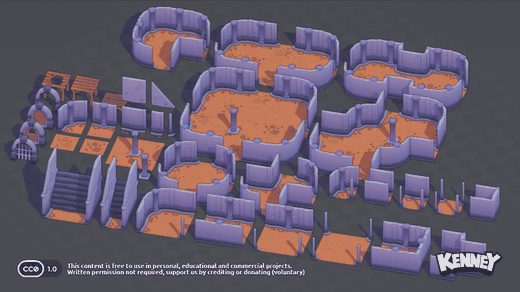 <b>Modular Dungeon Kit</b> 209 files · 39 GLB</td>
<td align="center" valign="top" width="33%">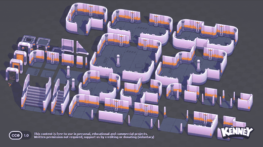 <b>Modular Space Kit</b> 214 files · 40 GLB</td>
</tr>
<tr>
<td align="center" valign="top" width="33%">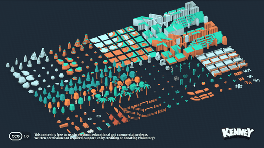 <b>Nature Kit</b> 1980 files · 329 GLB</td>
<td align="center" valign="top" width="33%">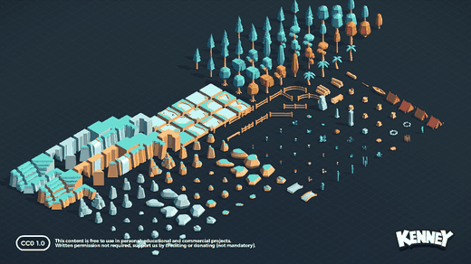 <b>Nature Kit (Classic)</b> 1186 files · 232 GLB</td>
<td align="center" valign="top" width="33%">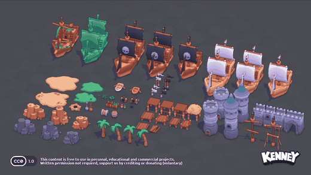 <b>Pirate Kit</b> 370 files · 72 GLB</td>
</tr>
<tr>
<td align="center" valign="top" width="33%">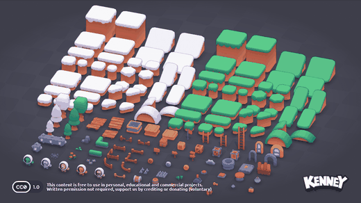 <b>Platformer Kit</b> 777 files · 153 GLB</td>
<td align="center" valign="top" width="33%">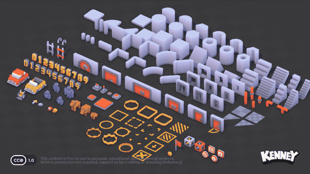 <b>Prototype Kit</b> 740 files · 145 GLB</td>
<td align="center" valign="top" width="33%">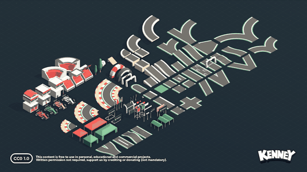 <b>Racing Kit</b> 687 files · 112 GLB</td>
</tr>
<tr>
<td align="center" valign="top" width="33%">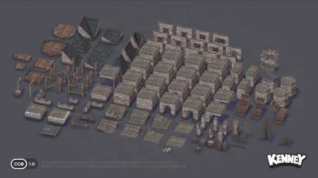 <b>Retro Fantasy Kit</b> 734 files · 160 GLB</td>
<td align="center" valign="top" width="33%">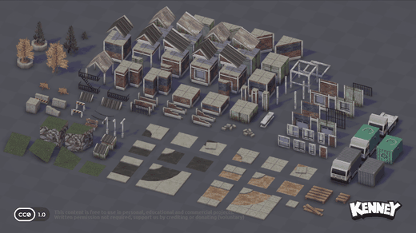 <b>Retro Urban Kit</b> 693 files · 124 GLB</td>
<td align="center" valign="top" width="33%">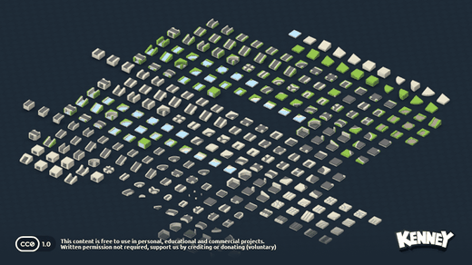 <b>Road Pack</b> 1770 files · 294 GLB</td>
</tr>
<tr>
<td align="center" valign="top" width="33%">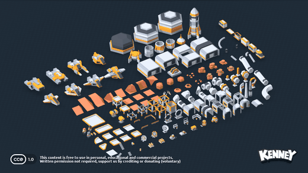 <b>Space Kit</b> 924 files · 153 GLB</td>
<td align="center" valign="top" width="33%">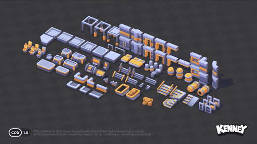 <b>Space Station Kit</b> 738 files · 177 GLB</td>
<td align="center" valign="top" width="33%">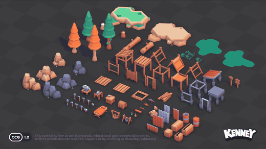 <b>Survival Kit</b> 412 files · 80 GLB</td>
</tr>
<tr>
<td align="center" valign="top" width="33%">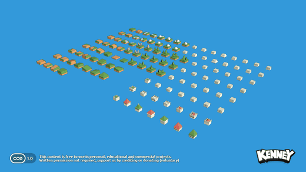 <b>Tower Defense (Classic)</b> 718 files · 119 GLB</td>
<td align="center" valign="top" width="33%">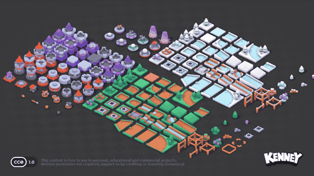 <b>Tower Defense Kit</b> 811 files · 160 GLB</td>
<td align="center" valign="top" width="33%"> <b>Toy Car Kit</b> 804 files · 157 GLB</td>
</tr>
<tr>
<td align="center" valign="top" width="33%"> <b>Train Kit</b> 527 files · 103 GLB</td>
<td align="center" valign="top" width="33%"> <b>Watercraft Pack</b> 239 files · 46 GLB</td>
<td align="center" valign="top" width="33%"> <b>Weapon Pack</b> 287 files · 37 GLB</td>
</tr>
</table>

## Early access (2)

<table>
<tr>
<td align="center" valign="top" width="33%"> <b>Medieval Weapons</b> 94 files · 17 GLB</td>
<td align="center" valign="top" width="33%"> <b>Racing Kit</b> 350 files · 68 GLB</td>
</tr>
</table>
