# UI, icons, audio and other

[← Back to the discussion](README.md)

## UI assets (10)

<table>
<tr>
<td align="center" valign="top" width="33%">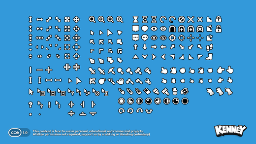 <b>Cursor Pack</b> 1096 files</td>
<td align="center" valign="top" width="33%">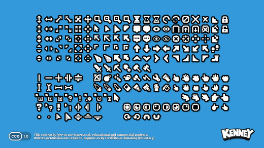 <b>Cursor Pixel Pack</b> 227 files</td>
<td align="center" valign="top" width="33%">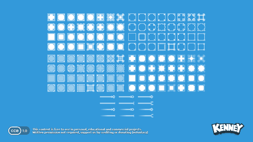 <b>Fantasy UI Borders</b> 286 files</td>
</tr>
<tr>
<td align="center" valign="top" width="33%">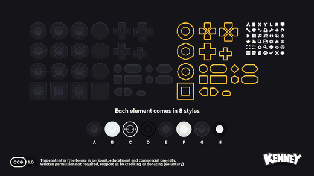 <b>Mobile Controls</b> 1435 files</td>
<td align="center" valign="top" width="33%">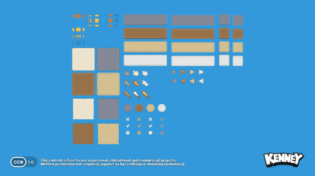 <b>UI Adventure Pack</b> 94 files</td>
<td align="center" valign="top" width="33%">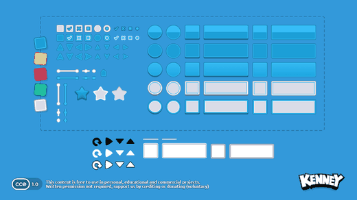 <b>UI Pack</b> 1325 files · 6 sounds · fonts</td>
</tr>
<tr>
<td align="center" valign="top" width="33%">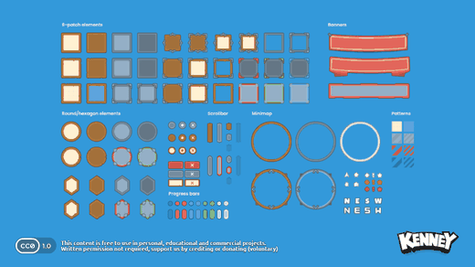 <b>UI Pack - Adventure</b> 393 files</td>
<td align="center" valign="top" width="33%">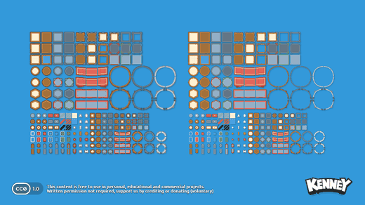 <b>UI Pack - Pixel Adventure</b> 517 files</td>
<td align="center" valign="top" width="33%">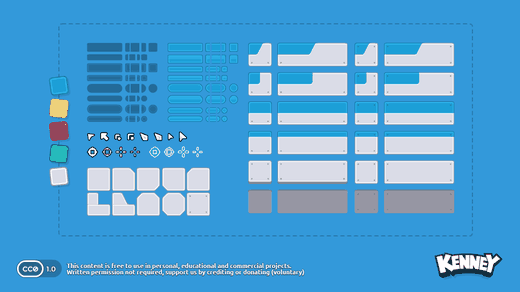 <b>UI Pack - Sci-fi</b> 1202 files · fonts</td>
</tr>
<tr>
<td align="center" valign="top" width="33%">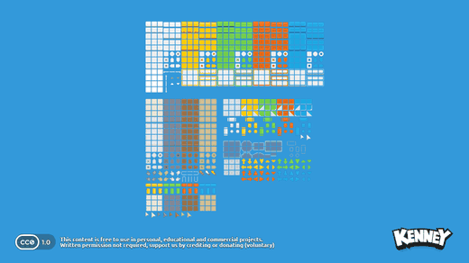 <b>UI Pixel Pack</b> 5 files</td>
</tr>
</table>

## Icons (8)

<table>
<tr>
<td align="center" valign="top" width="33%">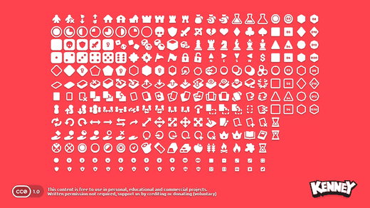 <b>Board Game Icons</b> 774 files</td>
<td align="center" valign="top" width="33%">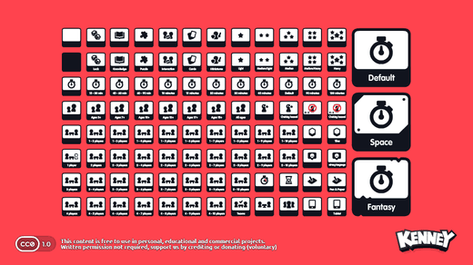 <b>Board Game Info</b> 866 files</td>
<td align="center" valign="top" width="33%">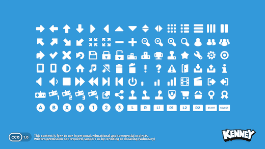 <b>Game Icons</b> 434 files</td>
</tr>
<tr>
<td align="center" valign="top" width="33%">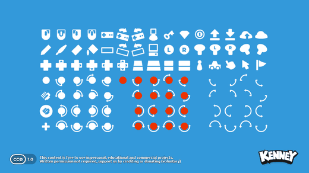 <b>Game Icons Expansion</b> 376 files</td>
<td align="center" valign="top" width="33%">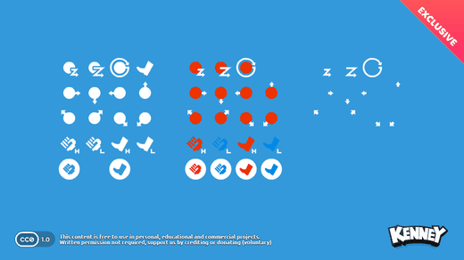 <b>Game Icons Fighter Expansion</b> 172 files</td>
<td align="center" valign="top" width="33%">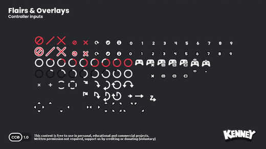 <b>Input Prompts</b> 4667 files · fonts</td>
</tr>
<tr>
<td align="center" valign="top" width="33%">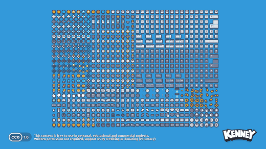 <b>Input Prompts Pixel</b> 821 files</td>
<td align="center" valign="top" width="33%">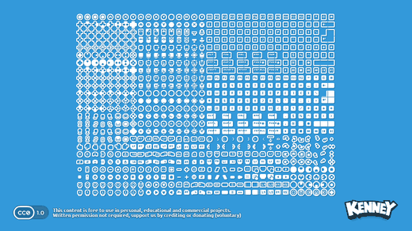 <b>Input Prompts Pixel 1-Bit</b> 1641 files</td>
</tr>
</table>

## Audio (16)

<table>
<tr>
<td align="center" valign="top" width="33%"> <b>Casino Audio</b> 57 files · 55 sounds</td>
<td align="center" valign="top" width="33%"> <b>Digital Audio</b> 64 files · 62 sounds</td>
<td align="center" valign="top" width="33%"> <b>Foley Sounds</b> 87 files · 85 sounds</td>
</tr>
<tr>
<td align="center" valign="top" width="33%"> <b>Impact Sounds</b> 132 files · 130 sounds</td>
<td align="center" valign="top" width="33%"> <b>Interface Sounds</b> 102 files · 100 sounds</td>
<td align="center" valign="top" width="33%"> <b>Music Jingles</b> 87 files · 85 sounds</td>
</tr>
<tr>
<td align="center" valign="top" width="33%"> <b>Music Loops</b> 31 files · 29 sounds</td>
<td align="center" valign="top" width="33%"> <b>RPG Audio</b> 53 files · 51 sounds</td>
<td align="center" valign="top" width="33%"> <b>Retro Sounds 1</b> 36 files · 34 sounds</td>
</tr>
<tr>
<td align="center" valign="top" width="33%"> <b>Retro Sounds 2</b> 67 files · 65 sounds</td>
<td align="center" valign="top" width="33%"> <b>Sci-Fi Sounds</b> 75 files · 73 sounds</td>
<td align="center" valign="top" width="33%"> <b>Synth Voice 1</b> 102 files · 100 sounds</td>
</tr>
<tr>
<td align="center" valign="top" width="33%"> <b>Synth Voice 2</b> 228 files · 225 sounds</td>
<td align="center" valign="top" width="33%"> <b>UI Audio</b> 53 files · 51 sounds</td>
<td align="center" valign="top" width="33%"> <b>Voiceover Pack</b> 96 files · 94 sounds</td>
</tr>
<tr>
<td align="center" valign="top" width="33%"> <b>Voiceover Pack Fighter</b> 49 files · 47 sounds</td>
</tr>
</table>

## Other (4)

<table>
<tr>
<td align="center" valign="top" width="33%"> <b>Construct samples 1</b> 12 files</td>
<td align="center" valign="top" width="33%">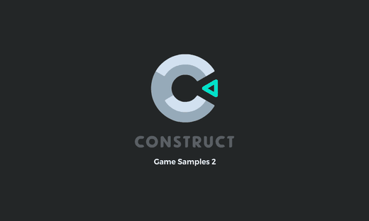 <b>Construct samples 2</b> 13 files</td>
<td align="center" valign="top" width="33%">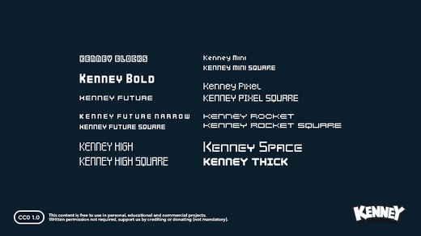 <b>Fonts</b> 19 files · fonts</td>
</tr>
<tr>
<td align="center" valign="top" width="33%">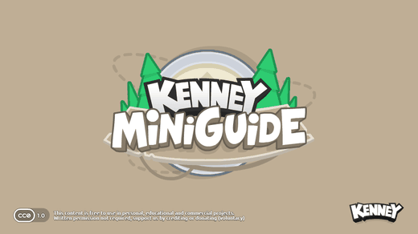 <b>Miniguides</b> 24 files</td>
</tr>
</table>
